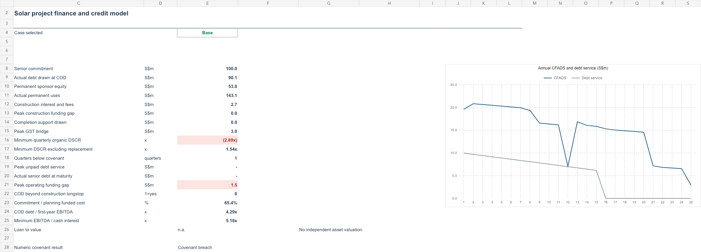

# Renewable Energy Project Finance & Credit Assessment

**Independent educational case study | Information cutoff: 17 November 2026**

Should a hypothetical DBS lender provide a **S$100 million commitment** to a hypothetical Sembcorp-sponsored Singapore rooftop solar SPV?

**Recommendation: decline the request as currently structured.** The model identifies a planned-replacement covenant breach, a downside payment shortfall and a severe construction-funding gap. It distinguishes coverage from payment liquidity: the base case pays scheduled debt from retained cash despite its organic DSCR breach.

This is a simulation, with no affiliation, endorsement, actual financing mandate or confidential information from either company. The 120 MWp asset, sites, contracts, terms and support commitments are hypothetical. Public sponsor observations are separately sourced.

[Public repository](https://github.com/herohelennn1010/renewable-energy-project-finance)

## Start here

Read the [viewing guide](docs/viewing_guide.md). For a quick review, open the PDF memo, then download the Excel file and start at Dashboard. GitHub previews documentation and the memo; Excel is used to operate the model.

## Deliverables

- [Excel model](model/renewable_project_finance.xlsx): linked construction, operating, tax, debt, reserve and cash-flow schedules; one scenario selector; two native What-If sensitivity tables.
- [Five-page credit committee memo](memo/credit_committee_memo.pdf): recommendation, sponsor analysis, model results, downside tests and restructuring requirements.
- [Editable memo narrative](memo/credit_committee_memo_source.md) and [validation report](validation/model_validation.md).



## Main results

| Metric | Base | Downside | Severe |
| --- | ---: | ---: | ---: |
| Senior debt drawn at COD, S$m | 90.15 | 100.00 | 100.00 |
| Minimum organic quarterly DSCR | -2.89x | -3.36x | -3.81x* |
| Minimum excluding replacement | 1.54x | 1.12x | 0.88x* |
| Peak unpaid debt service, S$m | 0.00 | 0.22 | Conditional* |
| Unfunded construction, S$m | 0.00 | 0.00 | 1.13 |

*Severe operating results assume completion despite its funding gap and missed longstop. They cannot establish bankability. The excluding-replacement measure is diagnostic, not the contractual covenant. No approvable debt capacity is inferred from that diagnostic alone.

## Use the workbook

1. Open the XLSX in a compatible spreadsheet application with automatic calculation enabled.
2. Set **Assumptions!E4** to 1 Base, 2 Upside, 3 Downside or 4 Severe.
3. Review Dashboard, then trace Operations, Debt, Cash_Flow, Tax and Construction.
4. Neutral sensitivity inputs **Sensitivity!E4:E7** are 1, 1, 0 and 1. Native tables vary two actual model inputs and restore the selected case. If your application does not support Excel What-If tables, use the linked case schedules and note that limitation.
5. Read full and excluding-replacement DSCR together. Reserve/cure cash never increases CFADS. A zero reconciliation difference or eventual repayment does not erase a covenant breach or earlier payment failure.

Build values are stored in SGD, generally displayed in S$m. Sponsor/Data values are already S$m. Blue indicates numeric inputs; green cross-sheet formulas; black same-sheet formulas and dashboard results.

## Evidence and method

| Reference | Content |
| --- | --- |
| [Case definition](docs/case_definition.md) | Borrower, geography, recourse and cutoff |
| [Sponsor assessment](docs/sponsor_assessment.md) | Three-year history and latest interim update |
| [Source register](docs/source_register.csv) | URLs, publication dates, locators and limits |
| [Assumptions](docs/assumptions_register.csv) | Original classified project inputs |
| [Implementation](docs/model_implementation.md) | Scenario design, resolved mechanics and added controls |
| [Methodology](docs/methodology.md) | Definitions and analytical perimeter |
| [Decision log](docs/decision_log.md) | Source conflicts and real-world diligence gaps |
| [Roadmap](PROJECT_B_ROADMAP.md) | Completed analysis and release status |

FY2023 is not recast; FY2024 is restated. Interim results are unaudited and unreviewed. Consolidated cash is not parent support capacity. LTV is not presented without an independent project valuation.

## Reproduction and verification

The workbook contains its own formulas and input/source tabs, without external workbook links or macros. Scenario switches, input boundaries, native sensitivity tables and exported OpenXML were checked. **55 checks passed. Native Microsoft Excel application recalculation was not independently verified.**

Standard-library Python checks use the supplied snapshots and XLSX:

```sh
python3 scripts/analyse_sponsor.py
python3 scripts/render_phase03_brief.py
python3 validation/validate_phase03.py
python3 validation/validate_model.py
```

These Python checks do not independently recalculate every Excel formula. Rebuilding requires the Codex bundled `@oai/artifact-tool` runtime and `model/inputs.json`: run `node scripts/build_model.mjs`. `PROJECT_B_RUNTIME` can specify the bundled dependency root. Memo generation additionally requires ReportLab and pypdf: `python3 scripts/create_credit_memo.py`. The release check also requires pypdf: `python3 validation/validate_release.py`. The formula map and code support audit; no network is required for calculation.

**Status:** Phases 0–7 complete, with verification limits disclosed. The public repository includes the model, memo, source data, code and validation. See the [release validation](validation/release_validation.md) and [publication receipt](validation/publication_receipt.json). Source reports are linked rather than redistributed.

## Contribution

This case study was developed with substantial AI assistance for research, modelling, code, drafting and checks. See the [contribution statement](docs/contribution_statement.md). It does not claim that the author independently wrote or manually verified every formula.
